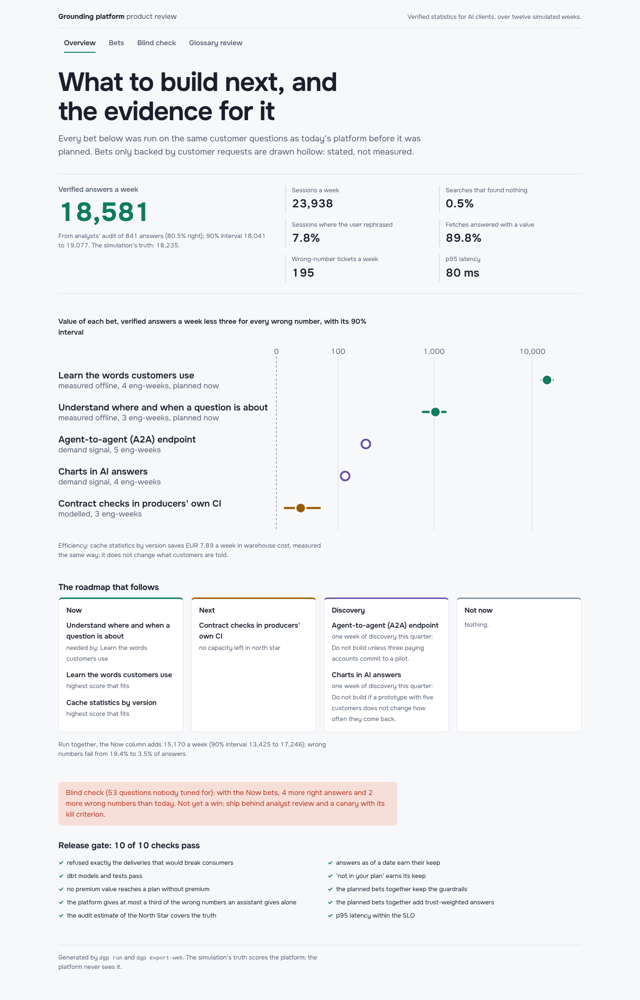

# data-grounding-platform

A platform that gets AI assistants to quote the right statistic, from the right revision, with the
right citation and licence, at a known cost per answer. On top of it sits the product layer that
decides **what to build next from measured evidence instead of opinion**.

Customers of a business-statistics publisher increasingly reach its data through Claude, Copilot,
Langdock, n8n and the publisher's own research assistant, over an API and an MCP server. The hard part
is not serving data; it is that an assistant will happily put a wrong number next to your citation.
This repository builds that platform slice and runs it for twelve simulated weeks against 700
customer accounts. Then it treats every roadmap item as a bet: it measures each one on the same
questions before planning it, and writes the strategy, roadmap, PRD, decision log and executive brief
from the results.



## What the platform does

| Layer | What it does | Where |
|---|---|---|
| Data contracts | Every delivery is checked against its topic's Open Data Contract Standard v3.1 contract: required fields, types, ranges, units registered per metric, versions only go up. Producers run the same check in their own CI (`dgp contract validate`, `dgp contract diff`). | `contracts/`, `platform/contracts.py` |
| The door | Accepted rows land in the warehouse. Refused deliveries are logged with their reasons. A revision is announced on the outbox (Kafka in production) if and only if it was stored. | `platform/ingest.py` |
| Warehouse | dbt models (DuckDB here, Snowflake-portable) keep every version of every statistic with the window it was live, with tests for one live version and no overlapping windows. | `dbt/` |
| Search | BM25 over titles, analysts' keywords and geography names. Optional **facets** turn a named geography and year into filters and say "not covered" for places outside the catalogue. An optional **glossary** is mined from rephrased MCP sessions and reviewed by analysts before it is served. | `platform/catalog.py`, `platform/glossary.py` |
| Grounding | A value for a year, from the version live at a date, with a citation and a revision notice. "Not in your plan", "no such year" or "not covered" instead of a number. Metering, monthly budgets and a cache keyed by version. | `platform/grounding.py` |
| Interfaces | FastAPI with hashed API keys; an MCP server (tools, a `stat://` resource template and a prompt) for any MCP client. | `service/` |

## What the product layer does

1. **North Star**: verified answers delivered a week, meaning right number, live version, with a
   citation. In production it is estimated from analysts' audit of 3% of answers; here the estimate is
   checked against the simulation's truth (18,581 estimated, 18,235 true, inside the interval).
2. **Bets as variants**: each bet in `config/product.yaml` is a feature flag or a producer workflow. It
   runs on the same questions of weeks 9 to 12, on top of whatever it needs. The glossary is learned
   from weeks 1 to 8 only. Differences are paired by account, with 90% intervals.
3. **Scoring**: value × confidence ÷ effort, inside an investment bucket.
   - Value counts a wrong number as three lost answers.
   - Confidence depends on how the evidence was obtained: measured, modelled, or only asked for.
   - Bets that break a guardrail are "not now"; prerequisites are planned with the bets that need them.
   - Demand-only bets get a discovery week, not a build slot.
4. **The Now column run together** before it is committed, in case the parts do not add up.
5. **Generated documents**: [strategy](reports/product/STRATEGY.md), [roadmap](reports/product/ROADMAP.md),
   [PRD](reports/product/PRD.md), [decision log](reports/product/DECISIONS.md) and
   [executive brief](reports/product/EXEC_BRIEF.md). Every number in them comes from
   `reports/results.json`; the judgement (problems, hypotheses, kill criteria) is in `config/product.yaml`.
6. **The PM's own AI workflow**: Claude Code skills `write-prd`, `review-roadmap` and
   `triage-feedback` (`.claude/skills/`), and `.mcp.json` to query the grounding server from Claude Code.

## Results

From [`reports/RESULTS.md`](reports/RESULTS.md), written by `dgp run` (about a minute) and checked in CI.

| Bet | Evidence | Value a week (90% interval) | Wrong numbers | Decision |
|---|---|---|---|---|
| Learn the words customers use (glossary) | measured | 14,135 (12,472 to 16,093) | 18.1% → 3.5% of answers | Now |
| Understand where and when a question is about (facets) | measured | 1,035 (772 to 1,312) | 19.4% → 18.1% | Now, needed by the glossary |
| Cache statistics by version | measured | EUR 7.89 saved; p95 99 → 90 ms | unchanged | Now (efficiency) |
| Contract checks in producers' own CI | modelled | 30 (10 to 60); refused-to-live 4.0 → 0.3 days | unchanged | Next: no capacity left |
| A2A endpoint, charts in answers | asked for, not measured | 200 and 120 (stated) | – | one discovery week each |

Run together, the Now column adds 15,170 a week (13,425 to 17,246), the sum of its parts.
Wrong numbers fall from 19.4% to 3.5% of answers. Two shipped features were switched off for the
same weeks and still earn their keep:
- answers as of a date: without them, 710 more stale numbers a week;
- "not in your plan" instead of a bare 403: without it, 842 more wrong numbers a week, as clients
  guessed what the error meant.

The contract gate refused exactly the 8 deliveries that would have broken consumers. No premium value
reached a plan without premium. Without the platform, an assistant answering from memory gave wrong
numbers 91% of the time.

## The blind check, and what it changed

Someone who had not seen the code wrote 53 questions from the public catalogue listing alone
([`heldout/WRITING_QUESTIONS.md`](heldout/WRITING_QUESTIONS.md)). The set was run once and its first
run is pinned ([`reports/heldout/questions-1/first_run.json`](reports/heldout/questions-1/first_run.json)).

| Platform | Right | Right numbers | Wrong numbers |
|---|---|---|---|
| Today | 38 of 53 | 23 | 9 |
| With the Now bets | 41 of 53 | 27 | 11 |

The planned bets answered four more questions but also gave two more wrong numbers. By the project's
own trust weighting that is **not yet a win on questions nobody tuned for**. The simulated customers'
vocabulary flattered the glossary. This is in the strategy and the brief, not hidden:
- the glossary ships only behind analyst review (the dashboard has the review queue) and a two-week
  canary with its kill criterion;
- the blind set is not studied, so it stays a fair test.

## Run it

```bash
uv sync
uv run dgp run                     # world, warehouse (dbt), production, bets, roadmap, documents, gate
uv run pytest -q                   # 60 tests (~1 min), incl. the API, the MCP server and the pipeline
uv run dgp ask "EV sales in Germany 2024" --plan team
uv run dgp contract validate mobility my-delivery.jsonl
uv run dgp keys issue acme --plan team && DGP_API_KEY=... uv run dgp serve-mcp
uv run dgp export-web && (cd web && npm ci && npm run dev)   # http://127.0.0.1:5208
```

The dashboard (React 19, motion, Onest) has four views: the evidence and roadmap, the bets, the blind
check, and the glossary review queue. Every view has loading, error and empty states. It is tested with
Vitest and with Playwright under the production CSP.

## Limits

- **The publisher and its customers are simulated.** How people phrase questions, how often an
  assistant answers from memory, and how long producer reviews take are assumptions in
  `config/world.yaml`. They drive every number above. The blind check exists because of that.
- **The client is a deterministic stand-in for an LLM.** It searches, takes the top result and fetches
  it. A real model would recover from some misses and add mistakes of its own.
- **Kafka, Snowflake and AWS are stood in for.** The outbox is a table, the warehouse is DuckDB, and
  the dbt models are written to run on Snowflake but were not run there.
- **Effort estimates are inputs.** The roadmap is only as good as those estimates and the capacity in
  `config/product.yaml`.
